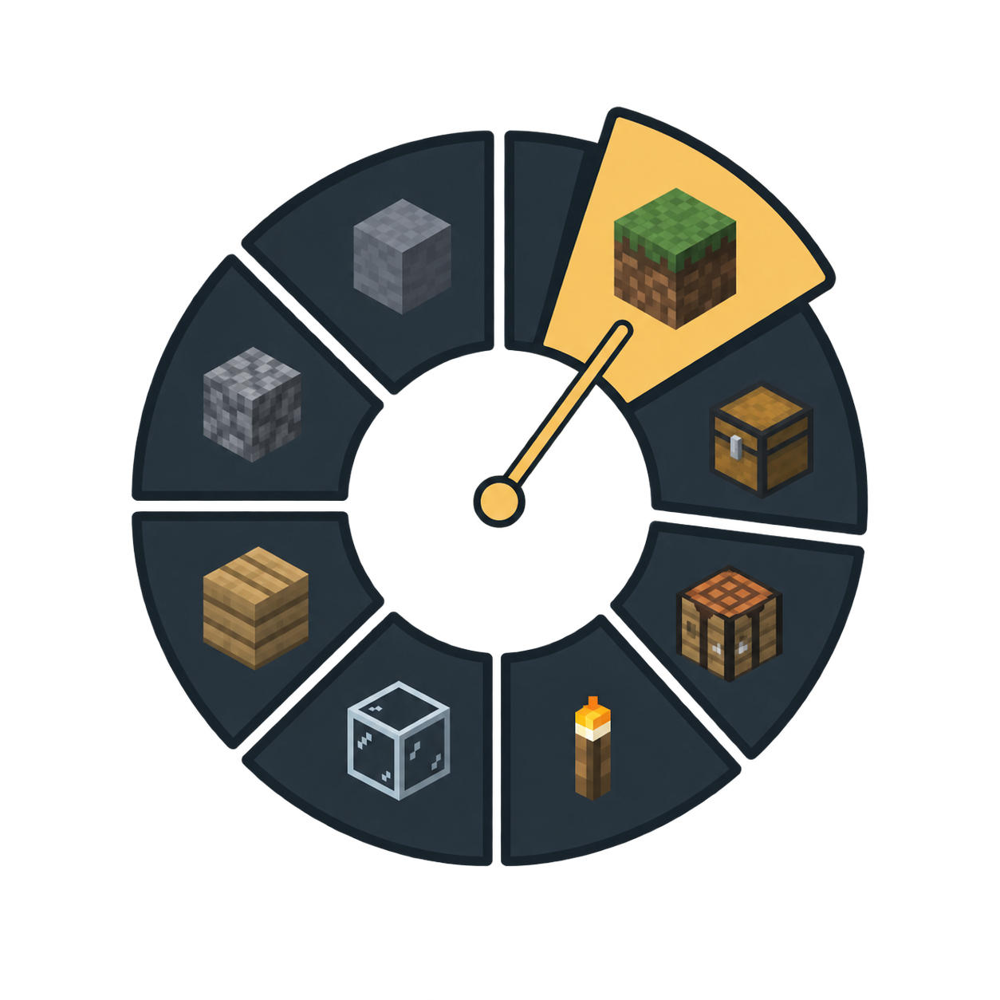

# Hotkey Wheel 1.2.1+26.3



A client-side Fabric mod for Minecraft Java 26.3. Create up to three radial menus with separate opening keys, assign Minecraft or registered mod controls, and choose floating icons: Hotkey Wheel's own, installed mods' or any block or item. Group slots into named folders. Hold or toggle a wheel, select by dragging from the center, and cycle wheels without releasing the original opener.

Version 1.2.1 is the first 1.2 release tested in a game, and fixes what that found: with Vanilla+ Features on the client as well, both mods now hear the server, and on light panels the remove-folder question, page counters and text fields are drawn cleanly. See [QA.md](QA.md). Version 1.2.0 gives the editor, pickers and dialogs a new [look](#look), **House**, with a switch back to a **Minecraft** look. It adds an [elytra flight switch](#elytra-flight) and, on servers running Vanilla+ Features, wheel actions that [open shulker boxes and ender chests](#shulker-boxes-and-ender-chests). Missing optional mods now always switch their integration off quietly. Version 1.2.0 was compiled and its integrations reviewed by reading their code; it was not run in a game. Version 1.1.3 moved the hint under the wheel up to the key line, so it no longer covers the hotbar, and was verified across the full matrix. Version 1.1.2 added [icons](#icons) of Hotkey Wheel's own and installed mods' icons to the icon picker, a key that opens the settings from an open wheel, [folders in the control chooser](#choosing-controls), and an editor with a **General** tab for the settings all wheels share. Version 1.1.1 added **Move to…** for moving slots and folders between levels, and **Mod settings** wheel actions that open a mod's settings screen. Slots saved with Blocktone's removed Toggle instant-break act as Buildprint's Toggle Excavator. Version 1.1.0 added folders: a slot can be a named folder with its own icon and up to 12 slots, and folders can hold folders. Minecraft's Key Binds screen now marks every control a wheel uses, with a tooltip naming where. Settings from 1.0.x load unchanged. Version 1.0.11 added Tool Pouch slot toggles as wheel actions. Version 1.0.10 updated the integrations to Buildprint 0.1.38 and Tool Pouch 1.2.0. Buildprint 0.1.38 reserves more keys inside its editor, for example C and E. A wheel bound to one of those keys now closes the editor it opened. Tool Pouch's disabled slots are respected, and an unreadable settings file is now kept as a copy instead of being replaced on the next Save. On a multiplayer server, the editor a wheel opens still closes with the original opener when Buildprint first asks which camera to use. Existing 1.0.8 settings and key bindings load unchanged. Version 1.1.3 was verified in a game with Vanilla++ 1.5.3, Buildprint 0.1.39 and Blocktone 0.1.39.1 in all five profiles. [AUDIT-2026-11-08.md](AUDIT-2026-11-08.md) lists every finding, and [API-MIGRATION.md](API-MIGRATION.md) covers the Buildprint hooks and input ordering.

## Install and configure

Requires **Minecraft 26.3**, **Fabric Loader 0.19.5+**, **Java 25+**, and **Fabric API 0.161.0+26.3 or newer for 26.3**. Replace older Hotkey Wheel JARs with `hotkey-wheel-1.2.1+26.3.jar` in your client's `mods` folder, then restart. Install only one Hotkey Wheel version. Servers do not need Hotkey Wheel.

Open **Options → Controls → Key Binds → Wheels…**, or use Hotkey Wheel's settings in Mod Menu. Controlling can search **hotkey wheel** to find the three opening keys, cycle key, configuration shortcut and the settings key for an open wheel. Sorted, Buildprint, Blocktone, Tool Pouch, Vanilla++, Vanilla+ Features, Controlling, Searchables, and Mod Menu are optional; Hotkey Wheel runs without them. Without one, its integration switches off: slots that use it stay saved and show as unavailable, with the reason.

- Wheel 1 defaults to **G** with **Hold** opening. Wheel 2 and 3 start unbound. **Cycle** defaults to **Tab**, and **Settings from an open wheel** to **U**.
- The editor has a **General** tab and a tab for each active wheel. **General** holds what all wheels share: **Active wheels**, the cycle, configure and settings keys, **Safe mode**, **Restore keys unbound by Hotkey Wheel**, the control chooser's mod folders and the integrations. A wheel's tab starts with its own settings: name, opening key, **Open mode** and **Outside wheel**. Its slots follow, each wheel with up to **12 slots**. Hidden wheels retain their settings. The editor opens on Wheel 1, or on the wheel you had open.
- Each slot has a searchable [control chooser](#choosing-controls), searchable [icon picker](#icons), optional label, and **Tap / Hold** action. Unbound registered controls can still be used through the wheel. Icons do not require inventory items. The chooser also lists Tool Pouch slot toggles and [mod settings](#mod-settings).
- **Add folder** creates a folder slot. See [Folders](#folders). **Move to…** moves the selected slot or folder to another level; see [Moving slots](#moving-slots).
- **Save** applies the draft and key changes. **Cancel** discards the draft. If saving fails, the editor keeps the draft for retry. Only the look is saved the moment it changes.
- The editor's tabs are in a column on the left. Under them, a **Description** box says what the setting under the pointer does; when the window is too short for it, the same text shows as a tooltip.

## Look

The editor, the control chooser, the icon picker, **Move to…** and the remove-folder question share one look. **House**, the default, has flat bevelled panels, light or dark, with one accent colour. **Minecraft** is drawn from the game's own buttons, text fields and creative-inventory panel, so resource packs restyle it. The footer's **Look: House** button switches between them; in House, **Colour** picks one of eight accents and the sun or moon button switches light and dark. The look is saved in `hotkey-wheel.json` as soon as you change it, Cancel included. The radial menus keep their own design in both looks.

## Elytra flight

**Toggle elytra flight** stops you from starting a glide, and turns it back on. It only stops Minecraft from asking the server to start gliding, so it works on any server, and with anything that glides: elytras, Vanilla+ Features' armored chestplates, Armored Elytra's combined items and other items with the `glider` component, worn or offered by another mod such as an elytra in a Tool Pouch. A glide already under way carries on. Use it as a wheel action (in the control chooser under **Hotkey Wheel actions**), as the **Hotkey Wheel: Toggle elytra flight** key in Key Binds (unbound at first), or with `/hotkeywheel elytra`, `/hotkeywheel elytra off` and `/hotkeywheel elytra on`. Each change shows above the hotbar and is saved, so it lasts until you change it. While flight is off, jumping in the air with a glider says so above the hotbar, at most every two seconds.

With Vanilla++ installed, its pouch elytra toggle does this job, so Hotkey Wheel offers neither the key, the command nor the action, and a saved **Off** has no effect. Slots that already use the action stay saved and show as unavailable.

## Shulker boxes and ender chests

On a server running Vanilla+ Features, two more wheel actions are under **Hotkey Wheel actions**:

- **Open ender chest** opens your ender chest through the first ender chest within reach that the server lists, usually one you carry.
- **Open shulker box…** opens an item radial, drawn like the Tool Pouch one, listing every shulker box and ender chest within reach: in your inventory, and where the server allows it inside your ender chest, bundles and shulker boxes (shulker boxes can't go in bundles). Hover one to see where it is, such as **Ender chest › Shulker box**, and click it to open it. Pages hold 12; the cycle key, arrows or scrolling turn them.

The server decides what can be opened and opens it; Hotkey Wheel only asks. Singleplayer counts when Vanilla+ Features is installed in the same game. Elsewhere both actions show as unavailable with the reason, such as **needs Vanilla+ Features on the server** or that the server has switched the feature off, and their slots stay saved.

Hotkey Wheel asks nothing until the server has said it supports this, sends one request at a time and no more than four a second, and only asks to open exactly what the server listed. The radial closes as soon as your inventory changes, since the list may no longer match; open it again for a fresh one. What is inside your ender chest only reaches the game while the ender chest is open, so a box moved there leaves the radial open; the server then refuses it, and its answer, such as that the box moved, shows above the hotbar.

## Using a wheel

**Hold:** hold the opening key, move toward an icon, and release to tap its control. **Toggle:** press once to open, then click an icon; pressing the original opener again also confirms the hovered entry.

The cursor starts in **Cancel**. Releasing or clicking there selects nothing. Escape and right click cancel. A line follows the cursor, and the hovered sector and floating icon move outward and brighten. The cycle key appears below the radial menu. Icons have no square frames. Under the wheel are the hovered entry's name, the cycle and settings keys, and a hint for the current mode, together just above the hearts and hotbar. On short screens, such as GUI scale 3 or 4 or a small window, the wheel moves up and if needed shrinks to keep them there, and on narrow screens the hint wraps. Folders and the Tool Pouch item radial are laid out the same way.

**Outside wheel: Cancel** is the default. **Select by direction** keeps the option under the cursor line selected beyond the outer edge, until the normal release or click confirms it. This setting is independent for each wheel.

Press **Settings from an open wheel** (**U** by default) while a wheel or one of its folders is open to edit it: the editor opens on that wheel's tab, inside the same folder, and closing it returns to the game. The key is shown under the wheel next to the cycle key. It does nothing while no wheel is open, so it never takes a key from normal play, and it may share a key with an ordinary control or with **Configure wheels**. It must differ from the wheel and cycle keys, and Safe mode reserves Escape and the primary mouse buttons for it as for the other wheel keys. Hotkey Wheel uses a key of its own here rather than **Configure wheels**, which starts unbound and works during normal play.

Press the cycle key to advance through enabled wheels. The original opening key and its Hold/Toggle gesture continue to apply after cycling. Another enabled wheel's own key can switch to that wheel while the radial is open.

For continuous controls, choose a slot's **Hold** action, open in Hold mode, and **click the slot while keeping the opening key held**. The action stays pressed until you release that key. Releasing over a slot without clicking still produces a tap. Another screen, focus loss, or disconnection releases held actions. Toggle opening uses Tap actions. Minecraft's own toggle-crouch/sprint/attack/use behavior remains available for Tap actions.

## Icons

**Choose icon…** on a slot or folder opens the icon picker. It offers three kinds of icon:

- **Hotkey Wheel's icons**, 39 simple light glyphs with a dark outline drawn for the wheel: cog, check mark, close (X), bulleted list, numbered list, plus, minus, star, heart, home, folder, search, pencil, trash, refresh, the four arrows, play, pause, lock, eye, info, warning, question mark, bookmark, flag, map pin, clock, sun, moon, bell, key, lightning, power, person, chat bubble and puzzle piece. Each has aliases, so **settings**, **gear** or **options** find the cog and **x** finds close.
- **Mods' icons**: every installed mod that declares an icon in its `fabric.mod.json`, found by the mod's name or ID. Built-in entries such as Minecraft and Java are left out, and so are mods bundled in another whose icon is the same picture, such as Fabric API's modules. Mods without an icon are not listed.
- **Blocks and items**, as before.

With an empty search, Hotkey Wheel's icons come first, then mods' icons by name, then blocks and items. A search looks through all three at once and shows the best matches first: an exact name or alias, then names starting with the search, then a word starting with it, then any other match. Equal matches keep that order: Hotkey Wheel's icons, mods' icons, blocks and items. Searching **book** shows the Book item, then the bookmark icon, then Bookshelf. Hotkey Wheel's and mods' icons draw before you join a world; blocks and items show their names there, as before.

A mod's icon is read once, fitted into a 64-pixel square that keeps its proportions, and kept while a wheel uses it; the others are freed when the picker closes. Icons that are missing, unreadable, not PNG or larger than 2048 pixels on a side show the puzzle piece instead. A slot whose mod has been removed keeps its saved icon and also shows the puzzle piece until the mod returns.

## Choosing controls

The control chooser opens on folders, in this order:

1. **Minecraft controls**, under Minecraft's own Key Binds categories.
2. **Mod settings**, the [mod settings](#mod-settings) actions, when Mod Menu is installed.
3. **Hotkey Wheel actions**: [Toggle elytra flight](#elytra-flight) (left out with Vanilla++), and [Open ender chest and Open shulker box…](#shulker-boxes-and-ender-chests), each with what it needs when it can't be used here.
4. A folder for each mod that adds controls, by the mod's name, with the mod's icon. Tool Pouch's slot toggles are in Tool Pouch's folder, Buildprint's controls in Buildprint's, and so on.
5. **Other controls**, for controls no mod can be credited with.

A control belongs to the mod whose code created it: Hotkey Wheel notes the creating class when each control is made and finds the mod that holds that class. A control that cannot be traced goes to the mod named by its Key Binds category, then by its name (`key.<modid>.…`), and otherwise to **Other controls**. A bundled mod, such as the Tool Pouch inside Vanilla++, has its own folder.

Choose a folder to open it; **‹ All folders** or Escape goes back. A folder with several Key Binds categories shows them as headings. Typing in the search box searches every folder at once and shows each match with its folder's name.

**Mod controls** in the **General** tab chooses **A folder for each mod** (the default) or **One Mod controls folder**, which lists every mod's controls together under each mod's name. Minecraft controls, Mod settings and Other controls stay separate.

## Folders

A folder is a slot with a name, an icon and up to 12 slots of its own. Those slots have the same options as a wheel's: control, icon, label, Tap / Hold and Unbind normal key. A folder can hold folders, three levels deep below the wheel. Every level costs a selection, and three keep the path above the radial on one line; the editor stops offering **Add folder** at the third level.

In the radial, a folder shows a small **»** beside its icon, and hovering it shows its name and slot count. Selecting a folder opens its slots as a radial with the same look. The path, such as **Wheel 1 › Tools › Picks**, is shown above it, and the center reads **Back**.

- **Hold:** click a folder while keeping the wheel key held, then release over a slot inside it, as at the top level. Hold actions work the same way inside folders. If you release the wheel key over a folder instead, the folder opens and stays open, and from then on a click chooses, like the Tool Pouch item radial. Hold actions chosen after that tap, as in Toggle mode.
- **Toggle:** click a folder to open it. Pressing the wheel key again also opens the hovered folder, or goes back from the center.
- **Back:** click the center to go up one level. Escape and right click also go up one level; at the top level they close the wheel. Releasing a held wheel key in the center still closes the wheel without an action, at any level.
- **Outside wheel** works inside folders as at the top level.
- The cycle key and the other wheels' keys switch wheels as before, starting at the new wheel's top level.

In the editor, select a folder slot to rename it, choose its icon (any of the [icons](#icons)), or **Open folder** to edit its slots. The path above the slots, such as **Wheel 1 › Tools**, leads back to each level. **Remove** asks before deleting a folder that holds slots; an empty folder is removed at once. Like every edit, nothing changes until **Save**.

### Moving slots

Select a slot or a folder in the editor and choose **Move to…**. A small picker lists the wheel's top level and every folder in it as a tree, each with its slot count. Choose one to move the selection there, after its last slot. A folder moves with everything in it. The picker greys out, with the reason in its tooltip:

- the level the slot is already in;
- a level that already holds 12 slots;
- a place where a folder would end up more than three levels below the wheel, counting the folders inside it;
- for a folder, the folder itself and every folder inside it.

The moved slot keeps its control, icon, label, Tap / Hold and Unbind normal key, and Hotkey Wheel's remembered keys stay as they are. Moves happen within the wheel you are editing. As with every edit, nothing changes until **Save**, and **Cancel** discards the move.

Everything else counts slots inside folders: Unbind normal key and its recovery keys, Safe mode, **Restore keys unbound by Hotkey Wheel**, Tool Pouch's Contextual Open and slot toggles, and the Buildprint and Blocktone menus that the original opener closes. Removing a folder whose slots were the last ones unbinding a control restores that control's key when you Save.

## Mod settings

The control picker's **Mod settings** group lists every installed mod that has a settings screen, with its name and icon; search for **settings** or the mod's name. A mod settings slot opens the same screen Mod Menu opens for that mod, and needs no key. This includes screens one mod provides for another, such as Buildprint's settings, and Minecraft's own options, which Mod Menu offers as Minecraft's settings. Mods without a settings screen are not listed.

The slot is saved as `modmenu:config/<modid>`. The screen opens with no parent, so closing it returns to the game. With **Wheel key closes menus it opened** on, pressing the original wheel opener again closes it and its child screens through their own Done, Cancel or Save handling, as for the Buildprint menus; a screen that refuses to close keeps its own warning. A Hold action opens the screen once. Mod settings slots work inside folders.

Mod Menu is needed to find the screens. Without it, mod settings slots stay in the configuration and show as **… settings (needs Mod Menu)**; selecting one only reports that. A slot whose mod has been removed shows **(mod not installed)**.

## Unbinding ordinary keys safely

Enable **Unbind normal key** on a slot to remove that control's ordinary keyboard or mouse assignment **when you Save**. The wheel can still activate it. Hotkey Wheel remembers the previous assignment before removing it.

**Safe mode** starts **ON**. It protects Inventory, Attack, Use, movement, Jump, Sneak, Sprint, Pick Block, chat/commands, and hotbar controls from automatic unbinding, including when those controls have custom keys. It also reserves Escape and the primary mouse buttons when assigning wheel, cycle, or configuration keys. Protected controls remain available as wheel entries.

Turn a slot's unbinding option off, remove its last active use with unbinding enabled (slots inside folders count as uses), or choose **Restore keys unbound by Hotkey Wheel**, then **Save** to restore remembered assignments. Turning Safe mode back on restores essential controls previously unbound by Hotkey Wheel when you Save. Later manual rebindings are preserved. If you Save again with unbinding still enabled, the newly removed binding becomes the recovery key. Controls that were already unbound have no earlier assignment to restore; keys belonging to an absent optional mod remain remembered until that mod returns.

## Marked controls in Key Binds

In **Options → Controls → Key Binds**, a small gold wheel appears left of the key button of every control that an active wheel uses, including slots inside folders. Hover it for a tooltip naming each place, such as **Wheel 1 › Tools › Pickaxe** (the slot's label, or its slot number). If Hotkey Wheel removed the control's key with Unbind normal key, the tooltip says so. The marker leaves the key button, the conflict highlight and the Reset button where they were. Controls only used on hidden wheels are not marked. Controlling's replacement key list shows the same marker; if a future Controlling changes its list, the marker is left out there and the list keeps working.

## Tool Pouch and Vanilla++

With **Tool Pouch contextual wheel: ON**, selecting Tool Pouch's **Contextual Open** control in a wheel automatically opens an item radial. This works with Tool Pouch 1.1.10 and 1.2.0, standalone or bundled in Vanilla++.

The item radial follows Tool Pouch's actual contextual menu: it shows **shulker boxes** normally, or **compatible ammunition** while holding a supported projectile weapon. Other stored tools/items are filtered exactly as the native contextual menu filters them, including pouch slots disabled in Tool Pouch 1.2.0. Selection uses Tool Pouch's normal networking and inventory behavior, with the original stack names, counts, and item data.

**Always click an item to select it**, including after opening from a Hold wheel. Releasing the original opening key leaves the item radial open. The center cancels; right click or Escape cancels. Larger lists use pages of 12 items, with the cycle key, arrows, or scrolling to change pages. The item radial selects by direction outside its edge. If the pouch contents or held weapon change before selection, reopen the radial.

### Tool Pouch slot toggles

Tool Pouch 1.2.0 can switch single pouch slots on and off, and binds those toggles to keys in its own pouch screen. They are not ordinary Minecraft controls, so the control picker lists them separately under **Tool Pouch slot toggles**. Each entry shows the slot's item, whether it is on or off, and its Tool Pouch key. **Toggle pouch Elytra** switches every elytra-like slot in the active pouch together. Selecting a toggle from a wheel uses Tool Pouch's own slot toggle and server message, so the server and the item tooltips stay in step.

A slot toggle works without a Tool Pouch key. With **Unbind normal key** on, Save removes the slot's Tool Pouch key and remembers it; turning the option off, removing the slot or **Restore keys unbound by Hotkey Wheel** puts it back. The elytra toggle covers several slots, so it has no single key to unbind. As with other controls, a wheel key takes precedence over a Tool Pouch toggle key on the same physical key.

Vanilla++ 1.5.1 and earlier had their own **Toggle Tool Pouch Elytra** control. Wheel slots that use it keep their saved setting. While that control exists, the wheel uses it as before; once Vanilla++ 1.5.2 removes it, the same slot toggles the pouch elytra through Tool Pouch. Vanilla++ moves a key that was still bound to its old control. If Hotkey Wheel had removed that key with **Unbind normal key**, the wheel holds the only copy. Turning the option off, removing the slot or **Restore keys unbound by Hotkey Wheel** then gives the key to the pouch's elytra slots that have no Tool Pouch key yet. An existing key is never replaced, and without a free elytra slot the key stays remembered. With Tool Pouch before 1.2.0, saved slot toggles stay in the wheel and are shown as needing Tool Pouch 1.2.

Enable **Native contextual key uses wheel** to use the same radial when pressing Tool Pouch's normal Contextual Open hotkey outside Hotkey Wheel. This option starts OFF. The radial requires the server's normal Tool Pouch support; Hotkey Wheel reports unavailable actions or empty contextual choices without inventing new pouch behavior. Disabling the contextual integration restores Tool Pouch's normal menu.

## Buildprint and Blocktone

**Wheel key closes menus it opened** (called **Wheel key closes Buildprint menus** before 1.1.1) starts ON. After a wheel opens Buildprint's menu, Selection Editor, Blocktone 0.1.39's instant-break settings or a mod's settings, press the **original wheel opener again** to close that menu and its child screens. This includes Buildprint's YACL settings and nested migration screens. Cycling wheels before selection keeps the original opening key as the closing key.

Closing uses each screen's normal save/cancel rules and commits Buildprint's pending edits. Invalid Blocktone settings can refuse closure and show their normal validation error; correct the fields and press the opener again. Menus opened through native Buildprint shortcuts or other routes retain their normal behavior. The Selection Editor is tracked by its freecam session rather than a screen parent. Its Save dialog can be canceled with the original opener before native editor exit. Public enter/exit events identify modern editor sessions; older Buildprint retains the private freecam fallback. Editors opened through their native binding remain independent; other non-menu controls retain their normal behavior.

Blocktone for Buildprint 0.1.39.1 replaced its instant-break with Buildprint's own excavator. Slots saved with **Toggle instant-break** keep their saved setting; while Blocktone 0.1.39 or earlier registers the control, it works as before, and once Blocktone 0.1.39.1 removes it, the same slot toggles Buildprint's **Toggle Excavator**. Unbind normal key on such a slot then removes and remembers the excavator's key. If Hotkey Wheel had removed a key from Toggle instant-break, Blocktone had no key to carry over, so the wheel holds the only copy: turning the option off, removing the slot or **Restore keys unbound by Hotkey Wheel** gives it to Toggle Excavator, unless Toggle Excavator already has a key, which is never replaced. Slots saved with Blocktone's removed **Instant-break settings** show as unavailable.

Buildprint 0.1.38 uses more raw keys inside the editor, such as C for the camera and the Drop and Inventory keys for switching tools. When a wheel opened the editor, its original opener closes it even if Buildprint uses that key; otherwise Buildprint's shortcuts work as usual. Opening another wheel while the editor is active still follows Buildprint's reserved keys. The walking-camera editor closes the same way as freecam. The first time you open the editor on a multiplayer server, Buildprint asks which camera to use. When a wheel asked for the editor, the session you start from that question belongs to the wheel, and the original opener closes it. Pressing the opener while the question is shown closes the question instead, and Escape cancels it as usual. Editors opened with Buildprint's own key are never claimed.

## Compatibility and configuration

Normal controls use their registered Minecraft `KeyMapping`. Screenshots, fullscreen, the Friends screen, debug overlay, and ordinary debug shortcuts use native handlers. Creative-only, spectator-only, server-restricted, and context-sensitive actions retain their normal requirements. The wheel does not synthesize the intentional debug-crash chord. For hotbar save/load, use a Hold action on the modifier while pressing a hotbar number.

Registered mod controls that poll keymapping state work through the wheel. Raw keyboard/mouse listeners may require a dedicated integration. Wheel keys take precedence over gameplay controls sharing those keys; selection and closing input do not activate those other controls. The editor rejects conflicting enabled wheel/cycle/configuration keys, and a settings key that matches a wheel or cycle key; Controlling retains its normal conflict display.

Wheel settings and recovery assignments are stored in `config/hotkey-wheel.json`; ordinary key assignments are stored in Minecraft's `options.txt`. Removing the JAR leaves configuration files intact.

Folders are stored as slots with an `entries` list of their own; ordinary slots are saved exactly as in 1.0.x, so 1.0.x and 1.1.0 settings load and save unchanged. Mod settings slots are ordinary slots whose `control` is `modmenu:config/<modid>`. Icons stay in each slot's `icon` field: a block or item ID such as `minecraft:chest`, one of Hotkey Wheel's icons as `hotkey_wheel:icon/<name>` (for example `hotkey_wheel:icon/cog`), or a mod's icon as `hotkey_wheel:mod/<modid>`. Hotkey Wheel registers no items and Fabric reserves each mod ID as its namespace, so these never name an item. An unknown item or icon name shows a barrier, as before. One Mod controls folder is saved as `"modControlsInOneFolder": true` and left out of the file when off, so 1.0.x and 1.1.x settings still save back unchanged. The settings key is stored in `options.txt` as `key_key.hotkey_wheel.settings`, and the elytra key as `key_key.hotkey_wheel.elytra_flight`. Hotkey Wheel's own actions are ordinary slots whose `control` is `hotkey_wheel:action/elytra_flight`, `hotkey_wheel:action/open_ender_chest` or `hotkey_wheel:action/open_shulker_box`. The look is saved as `"look": "minecraft"`, `"lightMode": true` and `"accent": "<colour>"`, and elytra flight off as `"elytraFlightOff": true`; each is left out of the file at its default (House, dark, blue, flight on), so 1.0.x and 1.1.x settings still load and save back unchanged. An unreadable settings file is still copied to `hotkey-wheel.json.unreadable` before a later Save can replace it. Restore automatically unbound keys through the editor before uninstalling if you want their remembered assignments back.

## Source, build, and verification

Repository: [THENATHE/hotkey-wheel](https://github.com/THENATHE/hotkey-wheel). This is an original client mod with no upstream port counterpart. The local source is `Minecraft/hotkey-wheel/`.

Use a complete Java 25 JDK and run `bash gradlew build`. Mod Menu 21.0.0, Buildprint 0.1.38+26.3 and Tool Pouch 1.2.0+26.3 resolve as optional compile APIs and are not bundled. Buildprint and Tool Pouch are pinned by Modrinth version ID, because their Fabric and NeoForge files share version numbers. [qa/upstream-inputs.json](qa/upstream-inputs.json) records the IDs and hashes. Existing local JARs can be supplied with `-PmodMenuJar=/path/to/modmenu-21.0.0.jar -PbuildprintJar=/path/to/buildprint-fabric-0.1.38+26.3.jar -PtoolPouchJar=/path/to/toolpouch-fabric-1.2.0+26.3.jar`.

Rendered development tests live in `qa/*Test.java` and run in isolated game directories; they do not install into the user's profile. The harness defaults to a Modrinth profile named Vanilla Fast. Set these environment variables for another machine:

```sh
export HOTKEY_WHEEL_JDK=/path/to/java-25-jdk
export HOTKEY_WHEEL_PROFILE="/path/to/ModrinthApp/profiles/Vanilla Fast"
export HOTKEY_WHEEL_META=/path/to/ModrinthApp/meta
python3 qa/run.py
python3 qa/run.py --integrated
python3 qa/run.py --toolpouch
python3 qa/run.py --suite
python3 qa/run.py --polymer
python3 qa/run.py --api-previous
python3 qa/run.py --api-baseline
python3 qa/run.py --legacy
```

The metadata directory must contain Minecraft 26.3, Fabric Loader 0.19.5 launcher metadata, libraries, natives, and assets. The Gradle cache supplies the Fabric client gametest API that matches the profile's Fabric API, so build once first. The runner starts its own 1920×1080 Xvfb on a free display from :150 up (`HOTKEY_WHEEL_QA_DISPLAY_BASE` moves the start), because `LayoutScaleTest` checks GUI scale 4 in a window that size. It gives the client an X11-only environment: the Wayland variables are removed, not just overridden, `XDG_RUNTIME_DIR` is a private empty folder, and SDL is told to use X11 with EGL, which Mesa needs on Xvfb. After launch it reads the client's `/proc/<pid>/environ`, stops it if anything could reach the desktop session, and records the result in `display-check.json`. Don't wrap it in `xvfb-run`, which only replaces `DISPLAY`. Each run starts from an empty mod `config/` folder in its isolated game directory. The integrated profile adds Controlling, Searchables, Sorted, Buildprint, Blocktone, Mod Menu, and YACL. The Tool Pouch profile adds standalone Tool Pouch 1.2.0 with Fzzy Config to the integrated set. The suite profile adds Vanilla++ 1.5.3, BRBR 1.11.8, and installed dependencies for actual Tool Pouch interactions, suite configuration navigation, and BRBR pin/settings coexistence. The runner reads the Tool Pouch version bundled in the tested suite JAR. The Polymer profile includes the same four-mod combination with the suite's supported Polymer 0.18.7+26.3 installation; the runner reads it from the suite workspace's `libs/installation/polymer-bundled-0.18.7+26.3.jar`, and `HOTKEY_WHEEL_POLYMER_JAR` selects another copy. `IconPickerTest`, `ControlFolderTest`, `EditorLayoutTest` and `LayoutScaleTest` run in every profile and cover the icons, the control chooser's folders, the editor's tabs with the settings key, and the layout of the wheel, its folders, the Tool Pouch item radial and Move to… at GUI scales 2, 3 and 4 and in 640×360 and 683×384 windows. `IconPickerTest` adds small fixture mods with a wide, a broken, a huge and a missing icon, and one without an icon, and leaves its saved settings and keys in `restart/`. Run the profile again with `HOTKEY_WHEEL_QA_RESTART_FROM` set to that run's folder and a new `HOTKEY_WHEEL_QA_RUN_ROOT` to start a second game with them (`RestartTest`). `UpgradeSourceTest`, run with an earlier release's JAR in `HOTKEY_WHEEL_JAR`, has that release write its own settings file; set `HOTKEY_WHEEL_QA_UPGRADE_DIR` to the folder holding those files to add `UpgradeTest` to a profile. `FolderWheelTest` runs last in every profile and covers folders, the editor, settings compatibility, controls with no key and the Key Binds marker, with Buildprint, Blocktone and Controlling when the profile has them. `MoveSlotTest` and `ModSettingsTest` run in every profile; without Mod Menu, the minimal profile checks that mod settings slots stay saved and show as unavailable. Set `HOTKEY_WHEEL_BUILDPRINT_VERSION` and `HOTKEY_WHEEL_BLOCKTONE_VERSION` together with their JAR variables to check another Buildprint and Blocktone pair, such as Blocktone 0.1.39 with its instant-break. `--no-blocktone` leaves Blocktone out and skips its checks; use it only to check a Buildprint release before its Blocktone build exists, because release packaging requires Blocktone.

`LookTest` and `ElytraFlightTest` run in every profile. `LookTest` screenshots and measures the editor, the control chooser, the icon picker, Move to… and the remove-folder question in House dark, House light and the Minecraft look at GUI scale 2 and 3; `ElytraFlightTest` glides in a singleplayer world, and with Vanilla++ checks that the switch is not offered. In profiles with Sorted, `QaSetupTest` first marks Sorted's first-run guide seen.

The Vanilla+ Features profile needs real dedicated servers, one at a time. `qa/test_server.py <folder> <port> [mod.jar…]` starts a Fabric 26.3 server with Fabric API, the mods named and a fresh flat world, with the fixtures' player as an operator. Start one with the Vanilla+ Features JAR and run `HOTKEY_WHEEL_QA_SERVER=127.0.0.1:<port> python3 qa/run.py --vpf`, then one without it and run with `HOTKEY_WHEEL_QA_PLAIN_SERVER` instead. `--vpf-client` also puts the newest Vanilla+ Features release on the client (`HOTKEY_WHEEL_VPF_JAR` picks another), so both mods share its messages; `--sorted` adds Sorted. With `--vpf-client` and no server, `ContainerActionsTest` uses the singleplayer world instead.

Set `HOTKEY_WHEEL_SUITE_JAR`, `HOTKEY_WHEEL_BRBR_JAR`, `HOTKEY_WHEEL_BUILDPRINT_JAR`, `HOTKEY_WHEEL_BLOCKTONE_JAR`, `HOTKEY_WHEEL_TOOLPOUCH_JAR`, or `HOTKEY_WHEEL_POLYMER_JAR` to test an exact candidate artifact; runtime reports and provenance record its declared version and SHA-256. `--prepare-only` builds the isolated QA profile and test JAR without launching a rendered client. The ten-area Buildprint API audit in [API-MIGRATION.md](API-MIGRATION.md) links the official documentation and records the relevant hooks and unused areas.

See [QA.md](QA.md) for current results, exact versions, and verification boundaries. The verification ZIP contains test reports, dependency hashes, and rendered screenshots. Local release folders additionally retain console logs and the earlier crash regression evidence. `python3 qa/package_release.py` packages only after every expected report passes against the final JAR; it validates archive/metadata/icon integrity and calculates assertion totals from the reports. QA code is excluded from the installable mod. Set `HOTKEY_WHEEL_BUILD_LOG`, `HOTKEY_WHEEL_ARTIFACT_DIFF`, and `HOTKEY_WHEEL_SOURCE_REBUILD` to include an exact build log, artifact comparison and independently reproduced-source proof. Shared build-index updates require `HOTKEY_WHEEL_UPDATE_INDEX=1`.

For a standalone checkout, set `HOTKEY_WHEEL_RELEASE_DIR=/path/to/release-folder` when running the packager. Private local crash evidence is copied only when present and is excluded from the public source archive.

The earlier 1.0.7 and 1.0.8 releases keep their own release folders, exact inputs and results. Version 1.0.9 was packaged locally but never published; its folder is kept as it was. Versions 1.0.10 and 1.0.11 have separate release folders and repeat the acceptance matrix against their own JARs; [QA.md](QA.md) records the current release's verification.

For future documentation-only reviews of an unchanged release, `HOTKEY_WHEEL_REVIEW_DATE` and optional `HOTKEY_WHEEL_REVIEW_QUALIFIER` create a separate review subfolder and explicitly require the original production binary to remain identical. A production fix such as 1.0.8 uses ordinary release packaging instead.

The simplified wheel icon was generated with the built-in imagegen tool. Hotkey Wheel's 39 picker icons are original pixel art drawn by `art/draw_glyphs.py`. See [ICON.md](ICON.md) for both.
