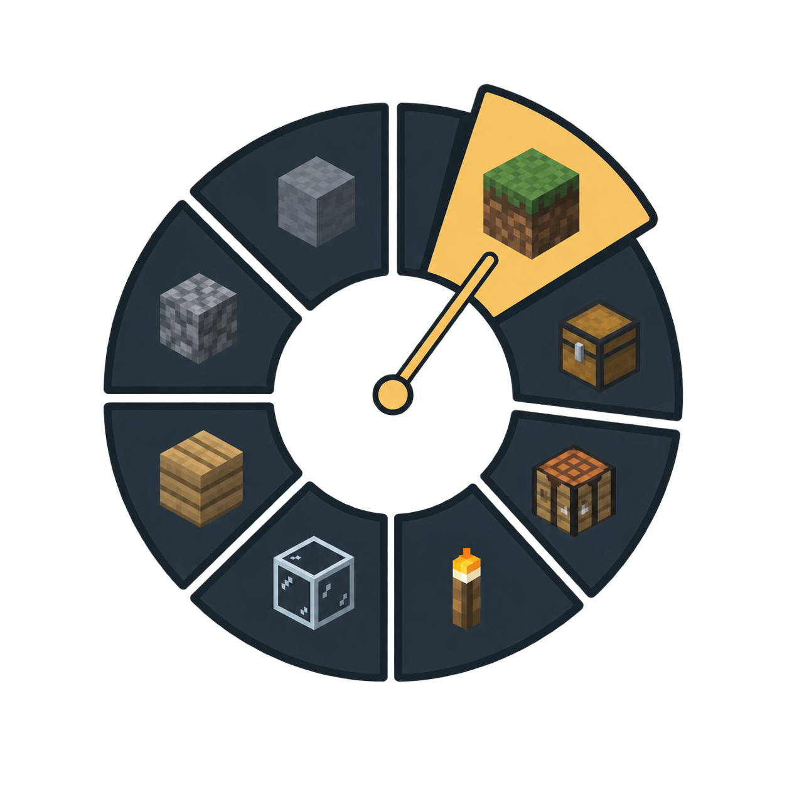

# Hotkey Wheel 1.0.8+26.3



A client-side Fabric mod for Minecraft Java 26.3. Create up to three radial menus with separate opening keys, assign Minecraft or registered mod controls, and choose floating block/item icons. Hold or toggle a wheel, select by dragging from the center, and cycle wheels without releasing the original opener.

Version 1.0.8 corrects the reported side-mouse editor-closing issue by running the existing ownership check before Buildprint's grabbed editor mouse handler. The native Mouse Button 4 regression and all 2,188 fresh checks pass, including the all-four native and Polymer profiles. The public editor open/close and screen-ownership APIs adopted in 1.0.7 remain in use. Dialogs still close through their normal save/cancel/validation handlers before editor exit, and native-opened editors remain independent. [API-MIGRATION.md](API-MIGRATION.md) records the input-ordering change, adopted hooks, and remaining API gaps.

## Install and configure

Requires **Minecraft 26.3**, **Fabric Loader 0.19.5+**, **Java 25+**, and **Fabric API 0.161.0+26.3 or newer for 26.3**. Replace older Hotkey Wheel JARs with `hotkey-wheel-1.0.8+26.3.jar` in your client's `mods` folder, then restart. Install only one Hotkey Wheel version. Servers do not need Hotkey Wheel.

Open **Options → Controls → Key Binds → Wheels…**, or use Hotkey Wheel's settings in Mod Menu. Controlling can search **hotkey wheel** to find the three opening keys, cycle key, and configuration shortcut. Sorted, Buildprint, Blocktone, Tool Pouch, Vanilla++, Controlling, Searchables, and Mod Menu are optional; Hotkey Wheel runs without them.

- Wheel 1 defaults to **G** with **Hold** opening. Wheel 2 and 3 start unbound. **Cycle** defaults to **Tab**.
- Choose **Active wheels** to enable up to three. Each wheel keeps its own name, opening mode, outside-edge behavior, and up to **12 slots**. Hidden wheels retain their settings.
- Each slot has a searchable control picker, searchable icon picker, optional label, and **Tap / Hold** action. Unbound registered controls can still be used through the wheel. Icons do not require inventory items.
- **Save** applies the draft and key changes. **Cancel** discards the draft. If saving fails, the editor keeps the draft for retry.

## Using a wheel

**Hold:** hold the opening key, move toward an icon, and release to tap its control. **Toggle:** press once to open, then click an icon; pressing the original opener again also confirms the hovered entry.

The cursor starts in **Cancel**. Releasing or clicking there selects nothing. Escape and right click cancel. A line follows the cursor, and the hovered sector and floating icon move outward and brighten. The cycle key appears below the radial menu. Icons have no square frames.

**Outside wheel: Cancel** is the default. **Select by direction** keeps the option under the cursor line selected beyond the outer edge, until the normal release or click confirms it. This setting is independent for each wheel.

Press the cycle key to advance through enabled wheels. The original opening key and its Hold/Toggle gesture continue to apply after cycling. Another enabled wheel's own key can switch to that wheel while the radial is open.

For continuous controls, choose a slot's **Hold** action, open in Hold mode, and **click the slot while keeping the opening key held**. The action stays pressed until you release that key. Releasing over a slot without clicking still produces a tap. Another screen, focus loss, or disconnection releases held actions. Toggle opening uses Tap actions. Minecraft's own toggle-crouch/sprint/attack/use behavior remains available for Tap actions.

## Unbinding ordinary keys safely

Enable **Unbind normal key** on a slot to remove that control's ordinary keyboard or mouse assignment **when you Save**. The wheel can still activate it. Hotkey Wheel remembers the previous assignment before removing it.

**Safe mode** starts **ON**. It protects Inventory, Attack, Use, movement, Jump, Sneak, Sprint, Pick Block, chat/commands, and hotbar controls from automatic unbinding, including when those controls have custom keys. It also reserves Escape and the primary mouse buttons when assigning wheel, cycle, or configuration keys. Protected controls remain available as wheel entries.

Turn a slot's unbinding option off, remove its last active use with unbinding enabled, or choose **Restore keys unbound by Hotkey Wheel**, then **Save** to restore remembered assignments. Turning Safe mode back on restores essential controls previously unbound by Hotkey Wheel when you Save. Later manual rebindings are preserved. If you Save again with unbinding still enabled, the newly removed binding becomes the recovery key. Controls that were already unbound have no earlier assignment to restore; keys belonging to an absent optional mod remain remembered until that mod returns.

## Tool Pouch and Vanilla++

With **Tool Pouch contextual wheel: ON**, selecting Tool Pouch's **Contextual Open** control in a wheel automatically opens an item radial. This works with Tool Pouch 1.1.10, including the copy bundled in Vanilla++ 1.4.4.

The item radial follows Tool Pouch's actual contextual menu: it shows **shulker boxes** normally, or **compatible ammunition** while holding a supported projectile weapon. Other stored tools/items are filtered exactly as the native contextual menu filters them. Selection uses Tool Pouch's normal networking and inventory behavior, with the original stack names, counts, and item data.

**Always click an item to select it**, including after opening from a Hold wheel. Releasing the original opening key leaves the item radial open. The center cancels; right click or Escape cancels. Larger lists use pages of 12 items, with the cycle key, arrows, or scrolling to change pages. The item radial selects by direction outside its edge. If the pouch contents or held weapon change before selection, reopen the radial.

Enable **Native contextual key uses wheel** to use the same radial when pressing Tool Pouch's normal Contextual Open hotkey outside Hotkey Wheel. This option starts OFF. The radial requires the server's normal Tool Pouch support; Hotkey Wheel reports unavailable actions or empty contextual choices without inventing new pouch behavior. Disabling the contextual integration restores Tool Pouch's normal menu.

## Buildprint and Blocktone

**Wheel key closes Buildprint menus** starts ON. After a wheel opens Buildprint's menu, Selection Editor, or Blocktone's instant-break settings, press the **original wheel opener again** to close that menu and its child screens. This includes Buildprint's YACL settings and nested migration screens. Cycling wheels before selection keeps the original opening key as the closing key.

Closing uses each screen's normal save/cancel rules and commits Buildprint's pending edits. Invalid Blocktone settings can refuse closure and show their normal validation error; correct the fields and press the opener again. Menus opened through native Buildprint shortcuts or other routes retain their normal behavior. The Selection Editor is tracked by its freecam session rather than a screen parent. Its Save dialog can be canceled with the original opener before native editor exit. Public enter/exit events identify modern editor sessions; older Buildprint retains the private freecam fallback. Editors opened through their native binding remain independent; other non-menu controls retain their normal behavior.

## Compatibility and configuration

Normal controls use their registered Minecraft `KeyMapping`. Screenshots, fullscreen, the Friends screen, debug overlay, and ordinary debug shortcuts use native handlers. Creative-only, spectator-only, server-restricted, and context-sensitive actions retain their normal requirements. The wheel does not synthesize the intentional debug-crash chord. For hotbar save/load, use a Hold action on the modifier while pressing a hotbar number.

Registered mod controls that poll keymapping state work through the wheel. Raw keyboard/mouse listeners may require a dedicated integration. Wheel keys take precedence over gameplay controls sharing those keys; selection and closing input do not activate those other controls. The editor rejects conflicting enabled wheel/cycle/configuration keys, and Controlling retains its normal conflict display.

Wheel settings and recovery assignments are stored in `config/hotkey-wheel.json`; ordinary key assignments are stored in Minecraft's `options.txt`. Removing the JAR leaves configuration files intact. Restore automatically unbound keys through the editor before uninstalling if you want their remembered assignments back.

## Source, build, and verification

Repository: [THENATHE/hotkey-wheel](https://github.com/THENATHE/hotkey-wheel). This is an original client mod with no upstream port counterpart. The local source is `Minecraft/hotkey-wheel/`.

Use a complete Java 25 JDK and run `bash gradlew build`. Mod Menu 21.0.0 and Tool Pouch 1.1.10+26.3 resolve as optional compile APIs and are not bundled. Existing local JARs can be supplied with `-PmodMenuJar=/path/to/modmenu-21.0.0.jar -PtoolPouchJar=/path/to/tool-pouch-1.1.10+26.3.jar`.

Rendered development tests live in `qa/*Test.java` and run in isolated game directories; they do not install into the user's profile. The harness defaults to a Modrinth profile named Vanilla Fast. Set these environment variables for another machine:

```sh
export HOTKEY_WHEEL_JDK=/path/to/java-25-jdk
export HOTKEY_WHEEL_PROFILE="/path/to/ModrinthApp/profiles/Vanilla Fast"
export HOTKEY_WHEEL_META=/path/to/ModrinthApp/meta
python3 qa/run.py
python3 qa/run.py --integrated
python3 qa/run.py --suite
python3 qa/run.py --polymer
python3 qa/run.py --api-previous
python3 qa/run.py --api-baseline
python3 qa/run.py --legacy
```

The metadata directory must contain Minecraft 26.3, Fabric Loader 0.19.5 launcher metadata, libraries, natives, and assets. The Gradle cache supplies the Fabric client gametest API. A graphical X11 session is required. The integrated profile adds Controlling, Searchables, Sorted, Buildprint, Blocktone, Mod Menu, and YACL. The suite profile adds Vanilla++ 1.4.4, BRBR 1.11.7, and installed dependencies for actual Tool Pouch interactions, suite configuration navigation, and BRBR pin/settings coexistence. The Polymer profile includes the same four-mod combination with the suite's supported Polymer 0.18.2+26.3 installation.

Set `HOTKEY_WHEEL_SUITE_JAR`, `HOTKEY_WHEEL_BRBR_JAR`, `HOTKEY_WHEEL_BLOCKTONE_JAR`, or `HOTKEY_WHEEL_POLYMER_JAR` to test an exact candidate artifact; runtime reports and provenance record its declared version and SHA-256. `--prepare-only` builds the isolated QA profile and test JAR without launching a rendered client. The ten-area Buildprint API audit in [API-MIGRATION.md](API-MIGRATION.md) links the official documentation and records the relevant hooks and unused areas.

See [QA.md](QA.md) for current results, exact versions, and verification boundaries. The verification ZIP contains test reports, dependency hashes, and rendered screenshots. Local release folders additionally retain console logs and the earlier crash regression evidence. `python3 qa/package_release.py` packages only after every expected report passes against the final JAR; it validates archive/metadata/icon integrity and calculates assertion totals from the reports. QA code is excluded from the installable mod. Set `HOTKEY_WHEEL_BUILD_LOG`, `HOTKEY_WHEEL_ARTIFACT_DIFF`, and `HOTKEY_WHEEL_SOURCE_REBUILD` to include an exact build log, artifact comparison and independently reproduced-source proof. Shared build-index updates require `HOTKEY_WHEEL_UPDATE_INDEX=1`.

For a standalone checkout, set `HOTKEY_WHEEL_RELEASE_DIR=/path/to/release-folder` when running the packager. Private local crash evidence is copied only when present and is excluded from the public source archive.

The earlier 1.0.7 release, its original tag/archives, and the 2026-10-13 four-mod review remain available with their own exact inputs and results. Version 1.0.8 has a separate release folder and repeats the complete acceptance matrix against its own JAR. Historical keyboard-opening coverage does not establish the new side-mouse regression; [QA.md](QA.md) records that distinction and the current release's verification.

For future documentation-only reviews of an unchanged release, `HOTKEY_WHEEL_REVIEW_DATE` and optional `HOTKEY_WHEEL_REVIEW_QUALIFIER` create a separate review subfolder and explicitly require the original production binary to remain identical. A production fix such as 1.0.8 uses ordinary release packaging instead.

The simplified wheel icon was generated with the built-in imagegen tool. See [ICON.md](ICON.md) for the saved asset and generation prompt.
